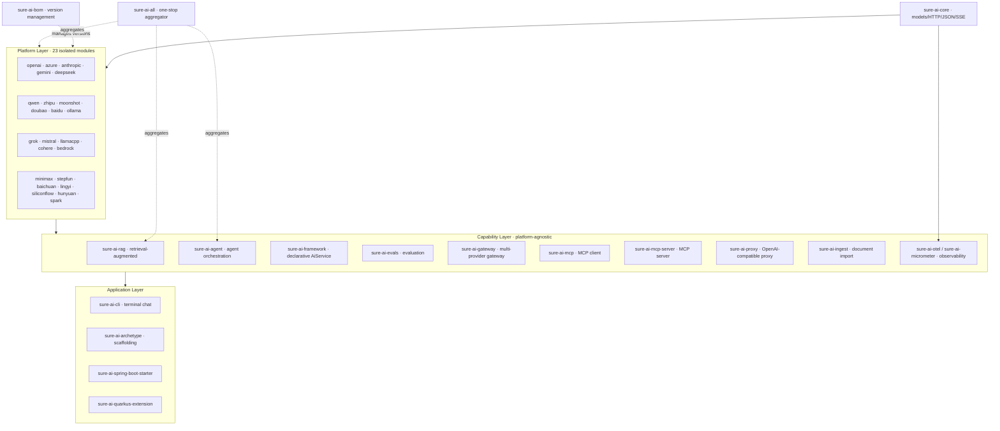
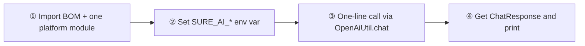
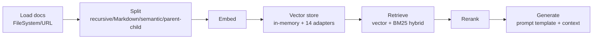
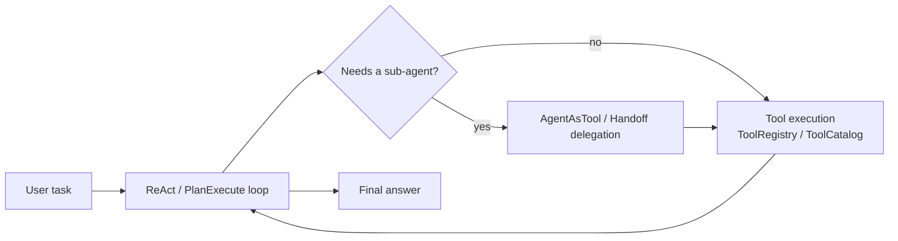

# sureai

> **Zero third-party dependency Java LLM integration toolkit.** One independent module and one static utility class per mainstream AI platform, with strict module-level isolation — pull in only what you need, call it in one line.

[](https://central.sonatype.com/artifact/io.github.tasure/sure-ai-core)
[](https://github.com/TASure/sureai/actions/workflows/ci.yml)
[](LICENSE)
[](docs/capabilities.md)
[](https://openjdk.org/projects/jdk/25/)
[](https://github.com/TASure/sureai/stargazers)
[](https://github.com/TASure/sureai/releases)

> The Stars / Downloads badges are live [shields.io](https://shields.io/) badges: Stars mirrors GitHub stars in real time; Downloads counts cumulative Release artifact downloads (showing 0 before the first release is expected). The latest released version is the Maven Central badge.

> **📖 English documentation track:** concept guides live in [`docs/en/`](docs/en/README.md) — start with the [5-minute Quick Start](docs/en/quickstart.md), then the [CLI](docs/en/cli.md) and [cookbook recipes](docs/COOKBOOK.md). The full Chinese documentation index is in [README.md](README.md).

## Why sureai

| Dimension | sureai | LangChain4j | Spring AI |
|-----------|--------|-------------|-----------|
| Third-party runtime deps | **Zero** (JDK + built-in JSON/HTTP; sole dep is `sure-core`) | Heavy transitive chain | Tied to Spring ecosystem |
| Zero-config usage | **Static utility, one-line call** (`OpenAiUtil.chat(...)`) | Requires Builder wiring | Requires `@Configuration` + Beans |
| Platform coverage | **All 23 platforms** (incl. Baidu, Zhipu, Doubao, MiniMax, Hunyuan, Spark) | Partial | Partial |
| Module isolation | **Per-module zero-dep**, pull only what you need | Monolithic | Monolithic |
| JDK requirement | **25+** | 17+ | 17+ |

## Architecture Overview

45 Maven modules in four layers — core → platform → capability → application. Zero third-party deps in the core; platform modules are isolated from each other:



**Design principles**: platform modules depend only on `sure-ai-core`; no inter-module dependencies. Built-in JSON parser and SSE reader (no third-party libraries). Static utilities lazily initialize with double-checked locking and read `SURE_AI_*` env vars when not explicitly configured. Platform-specific auth (JWT / cached access_token / SigV4, etc.) is encapsulated inside each module.

## Quick Start (5-minute)



**① Add dependencies** (BOM manages versions; OpenAI here — the other 22 coordinates in the [platform matrix](#platform-support-matrix)):

```xml
<dependencyManagement>
  <dependencies>
    <dependency>
      <groupId>io.github.tasure</groupId>
      <artifactId>sure-ai-bom</artifactId>
      <version>2.9.0</version>
      <type>pom</type>
      <scope>import</scope>
    </dependency>
  </dependencies>
</dependencyManagement>

<dependencies>
  <dependency>
    <groupId>io.github.tasure</groupId>
    <artifactId>sure-ai-openai</artifactId>
  </dependency>
</dependencies>
```

> To pull every platform + RAG + Agent at once, replace the platform dependency with the aggregator `sure-ai-all` (`<type>pom</type>`).

**② Configure the environment**:

```bash
export SURE_AI_OPENAI_API_KEY=sk-xxx
```

**③ One-line call**:

```java
import com.sure.ai.openai.OpenAiUtil;

String reply = OpenAiUtil.chat("gpt-4o-mini", "Hello!").firstText();
System.out.println(reply);
```

**④ Run**: JDK 25+, just run the main method. More copy-paste scenarios: [docs/COOKBOOK.md](docs/COOKBOOK.md).

## Core Capabilities

| Capability | Module | One-liner | Docs |
|------------|--------|-----------|------|
| Chat / Streaming / Embedding | `sure-ai-*` (platform modules) | Unified protocol engine over 23 platforms, SSE streaming callbacks | [capabilities.md](docs/capabilities.md) |
| Image / Video / Speech | `sure-ai-*` | `ImageClient`/`VideoClient`/`AudioClient`; async platforms poll internally, synchronous API | [images.md](docs/images.md) · [video.md](docs/video.md) · [audio.md](docs/audio.md) |
| RAG | `sure-ai-rag` | Load → split → embed → retrieve (vector + BM25 hybrid) → rerank → generate | [rag.md](docs/rag.md) |
| Agent orchestration | `sure-ai-agent` | ReAct / Plan-Execute / parallel multi-agent / checkpoints / HITL / memory / Skills / sub-agents / tool catalog | [agent.md](docs/agent.md) · [agent-skills.md](docs/agent-skills.md) |
| Declarative AiService | `sure-ai-framework` | Interface + annotations → JDK dynamic proxy AI service; Advisor chain + semantic cache | [framework.md](docs/framework.md) |
| Evaluation | `sure-ai-evals` | Dataset → metrics (deterministic/semantic/LLM-judge) → reports → CI assertions → record & replay | [evals.md](docs/evals.md) |
| AI Gateway | `sure-ai-gateway` | Multi-provider routing / failover / circuit breaker / key pool / quotas | [gateway.md](docs/gateway.md) |
| MCP client / server | `sure-ai-mcp` / `sure-ai-mcp-server` | Consume MCP tools; expose sureai capabilities as an MCP server | [mcp.md](docs/mcp.md) · [mcp-server.md](docs/mcp-server.md) |
| Document ingest | `sure-ai-ingest` | Local files / URLs → `Document`; TXT/MD/HTML/PDF built-in (POI optional) | [ingest.md](docs/ingest.md) |
| Observability | `sure-ai-otel` / `sure-ai-micrometer` | OTel GenAI semantic conventions / Micrometer / Langfuse export | [observability.md](docs/observability.md) |
| Production resilience | `sure-ai-core` | Retry callbacks / rate limiting / circuit breaker / response cache / cost metering | [observability.md](docs/observability.md) · [cache.md](docs/cache.md) |

## Platform Support Matrix

23 platforms — one isolated module and static utility per platform (core capability columns; the full 22-capability matrix lives in [docs/capabilities.md](docs/capabilities.md)):

| Platform | artifactId | Streaming | Embedding | Image | Video | Speech TTS/STT | Function Calling |
|----------|-----------|-----------|-----------|-------|-------|----------------|------------------|
| OpenAI | `sure-ai-openai` | ✅ | ✅ | ✅ DALL·E 3 | ✅ Sora 2 | ✅ / ✅ | ✅ |
| Azure OpenAI | `sure-ai-azure` | ✅ | ✅ | ✅ DALL·E 3 | ✅ Sora 2 | ✅ / ✅ | ✅ |
| Anthropic | `sure-ai-anthropic` | ✅ | ❌ | ❌ | ❌ | ❌ | ✅ |
| Google Gemini | `sure-ai-gemini` | ✅ | ✅ | ✅ Imagen | ❌ Veo | ❌ | ✅ |
| DeepSeek | `sure-ai-deepseek` | ✅ | ❌ | ❌ | ❌ | ❌ | ✅ |
| Qwen (Tongyi) | `sure-ai-qwen` | ✅ | ✅ | ✅ Wanx | ✅ Wan | ✅ / ✅ | ✅ |
| Zhipu GLM | `sure-ai-zhipu` | ✅ | ✅ | ✅ CogView | ✅ CogVideoX | ✅ / ✅ | ✅ |
| Moonshot | `sure-ai-moonshot` | ✅ | ✅ | ❌ | ❌ | ❌ | ✅ |
| Doubao | `sure-ai-doubao` | ✅ | ✅ | ❌ | ✅ Seedance | ✅ / ✅ | ✅ |
| Baidu Qianfan | `sure-ai-baidu` | ✅ | ✅ | ✅ ERNIE-ViLG | ❌ | ✅ / ✅ | ✅ |
| Ollama | `sure-ai-ollama` | ✅ | ✅ | ❌ | ❌ | ❌ | ✅ |
| Grok (xAI) | `sure-ai-grok` | ✅ | ❌ | ❌ | ❌ | ❌ | ✅ |
| Mistral | `sure-ai-mistral` | ✅ | ✅ | ❌ | ❌ | ❌ | ✅ |
| Cohere | `sure-ai-cohere` | ✅ | ✅ | ❌ | ❌ | ❌ | ✅ |
| llama.cpp | `sure-ai-llamacpp` | ✅ | ✅ | ❌ | ❌ | ❌ | ✅ |
| AWS Bedrock | `sure-ai-bedrock` | ✅ | ❌ | ❌ | ❌ | ❌ | ✅ |
| MiniMax | `sure-ai-minimax` | ✅ | ❌ | ❌ | ❌ | ❌ | ✅ |
| StepFun | `sure-ai-stepfun` | ✅ | ❌ | ❌ | ❌ | ❌ | ✅ |
| Baichuan | `sure-ai-baichuan` | ✅ | ❌ | ❌ | ❌ | ❌ | ✅ |
| 01.AI (Lingyi) | `sure-ai-lingyi` | ✅ | ❌ | ❌ | ❌ | ❌ | ✅ |
| SiliconFlow | `sure-ai-siliconflow` | ✅ | ✅ | ❌ | ❌ | ❌ | ✅ |
| Tencent Hunyuan | `sure-ai-hunyuan` | ✅ | ✅ | ❌ | ❌ | ❌ | ✅ |
| iFlytek Spark | `sure-ai-spark` | ✅ | ❌ | ❌ | ❌ | ❌ | ✅ |

Per-platform docs: `docs/platforms/` plus [bedrock.md](docs/bedrock.md) / [cohere.md](docs/cohere.md) / [grok.md](docs/grok.md) / [mistral.md](docs/mistral.md) / [llamacpp.md](docs/llamacpp.md).

## Key Flow Examples

### Streaming

```java
OpenAiUtil.chatStream(
    ChatRequest.builder()
        .model("gpt-4o-mini")
        .messages(List.of(ChatMessage.user("Introduce Java in one sentence.")))
        .build(),
    chunk -> { if (chunk.deltaText() != null) System.out.print(chunk.deltaText()); }
);
```

### Function Calling

```java
ToolFunction weatherFn = ToolFunction.of("getWeather", "Get current weather for a city",
    "{\"type\":\"object\",\"properties\":{\"city\":{\"type\":\"string\"}},\"required\":[\"city\"]}");

ChatRequest req = ChatRequest.builder()
    .model("gpt-4o-mini")
    .messages(List.of(ChatMessage.user("What is the weather in Shanghai today?")))
    .tools(List.of(ToolSpec.of(weatherFn)))
    .build();

ChatResponse resp = OpenAiUtil.chat(req);
// Execute the tool, then append the result as ChatMessage.tool(toolCallId, result) and re-request
```

### RAG



```xml
<dependency>
  <groupId>io.github.tasure</groupId>
  <artifactId>sure-ai-rag</artifactId>
  <version>2.9.0</version>
</dependency>
```

```java
OpenAiClient client = OpenAiClient.builder().apiKey("sk-xxx").build();

RagPipeline pipeline = RagUtil.pipeline(client, client,
    OpenAiModels.GPT_4O_MINI, OpenAiModels.TEXT_EMBEDDING_3_SMALL);

pipeline.ingest("sureai-intro", "sureai is a zero-dependency Java LLM toolkit...");
ChatResponse answer = pipeline.ask("What capabilities does sureai support?");
```

Advanced: 13 external vector-store adapters (Milvus/Chroma/Qdrant/Pinecone/Weaviate/Elasticsearch/OpenSearch/Redis/PGVector/Typesense/Cassandra/MongoDB/Neo4j — 14 implementations total); retrieval strategies incl. HyDE / Multi-Query (RRF) / CRAG / parent-child / semantic chunking / multimodal RAG / GraphRAG / RAG evaluation. See [docs/rag.md](docs/rag.md), [docs/vector-stores.md](docs/vector-stores.md).

### Agent Orchestration



```java
ToolRegistry registry = new ToolRegistry();
registry.register(DateTimeTool.INSTANCE);
registry.register(HttpTool.builder().ssrfGuard(...).build());

ReActAgent agent = ReActAgent.builder()
    .client(client)
    .model("gpt-4o-mini")
    .registry(registry)
    .build();

String answer = agent.run("What day of the week is it today?");
```

More: parallel multi-agent (`AgentOrchestrator`), checkpoint persistence, HITL approval, long-term memory, Agent Skills (progressive SKILL.md loading), hierarchical sub-agent delegation, `ToolCatalog` marketplace, MCP tool integration. See [docs/agent.md](docs/agent.md), [docs/agent-advanced.md](docs/agent-advanced.md), [docs/agent-skills.md](docs/agent-skills.md), [docs/mcp.md](docs/mcp.md).

## Ecosystem & Tooling

| Tool | Module | Description | Docs |
|------|--------|-------------|------|
| Spring Boot Starter | `sure-ai-spring-boot-starter` | Auto-configuration + `@Autowired` injection | [spring-boot.md](docs/spring-boot.md) |
| Quarkus extension | `sure-ai-quarkus-extension` | Arc synthetic beans, conditional assembly | [quarkus-extension.md](docs/quarkus-extension.md) |
| CLI | `sure-ai-cli` | `chat / stream / rag / list / repl` — use the library without Java | [cli.md](docs/cli.md) |
| Archetype | `sure-ai-archetype` | One `mvn archetype:generate` to scaffold a project | [COOKBOOK.md](docs/COOKBOOK.md) |
| Examples | `sure-ai-examples` | Offline runnable demos (`ExamplesRunner`) | [COOKBOOK.md](docs/COOKBOOK.md) |
| Native image | all modules | GraalVM metadata, no hand-written config | [native-image.md](docs/native-image.md) |
| OpenAI-compatible proxy | `sure-ai-proxy` | Standalone HTTP service (LiteLLM proxy pattern) | [proxy.md](docs/proxy.md) |
| Cost metering | `sure-ai-core` | Price catalog + per-call / aggregate cost | [cost.md](docs/cost.md) |
| Full async | `sure-ai-core` | `AsyncClients` virtual-thread wrappers | [async.md](docs/async.md) |

## Environment Variables

Uniform rule: **`SURE_AI_<PLATFORM>_API_KEY`** (required, except Ollama) + **`SURE_AI_<PLATFORM>_BASE_URL`** (optional, overrides the default endpoint). Special cases:

- **Baidu Qianfan**: also needs `SURE_AI_BAIDU_SECRET_KEY` (access_token cached automatically)
- **Zhipu**: `SURE_AI_ZHIPU_API_KEY` is `id.secret` (SDK generates JWT)
- **iFlytek Spark**: `SURE_AI_SPARK_API_KEY` is the console `APIPath:APIKey` pair
- **Azure**: `SURE_AI_AZURE_RESOURCE` (resource name) or `SURE_AI_AZURE_BASE_URL` (full endpoint)

Full mapping: per-platform docs in `docs/platforms/`.

## Documentation Index

| Topic | Docs |
|-------|------|
| Getting started / scenarios | [COOKBOOK.md](docs/COOKBOOK.md) · [faq.md](docs/faq.md) · [docs/en/](docs/en/README.md) |
| Design | [design.md](docs/design.md) · [capabilities.md](docs/capabilities.md) · [comparison.md](docs/comparison.md) · [strategy-comparison.md](docs/strategy-comparison.md) |
| Chat capabilities | [thinking.md](docs/thinking.md) · [structured-output.md](docs/structured-output.md) · [multimodal.md](docs/multimodal.md) · [grounding.md](docs/grounding.md) · [batches.md](docs/batches.md) · [prompt-template.md](docs/prompt-template.md) · [realtime.md](docs/realtime.md) |
| Media generation | [images.md](docs/images.md) · [video.md](docs/video.md) · [audio.md](docs/audio.md) · [rerank.md](docs/rerank.md) |
| RAG / vector stores | [rag.md](docs/rag.md) · [vector-stores.md](docs/vector-stores.md) · [ingest.md](docs/ingest.md) |
| Agent / MCP | [agent.md](docs/agent.md) · [agent-advanced.md](docs/agent-advanced.md) · [agent-skills.md](docs/agent-skills.md) · [mcp.md](docs/mcp.md) · [mcp-server.md](docs/mcp-server.md) |
| Framework / gateway | [framework.md](docs/framework.md) · [gateway.md](docs/gateway.md) · [proxy.md](docs/proxy.md) |
| Evaluation / observability | [evals.md](docs/evals.md) · [observability.md](docs/observability.md) · [cost.md](docs/cost.md) · [cache.md](docs/cache.md) · [circuit-breaker.md](docs/circuit-breaker.md) |
| Platform specifics | [bedrock.md](docs/bedrock.md) · [cohere.md](docs/cohere.md) · [grok.md](docs/grok.md) · [mistral.md](docs/mistral.md) · [llamacpp.md](docs/llamacpp.md) |
| Engineering | [benchmark.md](docs/benchmark.md) · [native-image.md](docs/native-image.md) · [cli.md](docs/cli.md) · [RELEASING.md](docs/RELEASING.md) · [trust.md](docs/trust.md) |

## Building

```bash
# Requires JDK 25+ and Maven 3.9+
mvn -B clean verify
```

Runs: compile → unit tests (3200+, zero real network) → checkstyle → spotbugs → jacoco coverage gate (≥98%) → license header check.

## Contributing

Issues and PRs are welcome! See [CONTRIBUTING.md](CONTRIBUTING.md).

## Discussions & Support

- **Questions / ideas / roadmap**: post in [GitHub Discussions](https://github.com/TASure/sureai/discussions) (check pinned Q&A posts first; roadmap/version planning goes in *Roadmap*).
- **Bugs & feature requests**: [Issues](https://github.com/TASure/sureai/issues) with the issue template.
- **Security vulnerabilities**: do **not** open a public Issue or Discussion — report privately per [SECURITY.md](SECURITY.md).
- **Supply-chain integrity / verifying artifacts**: [docs/trust.md](docs/trust.md).

## Development & Governance

Iterations are run by the "software research & development team": the team lead coordinates requirements and acceptance, the product manager defines requirements and acceptance criteria, the software architect designs modules and APIs, engineers implement, and a full-stack code reviewer independently audits (P0/P1/P2 tiers). See [docs/TEAM.md](docs/TEAM.md); machine-readable config in [`.team/`](.team/).

## License

[Apache License 2.0](LICENSE) © sureai contributors
