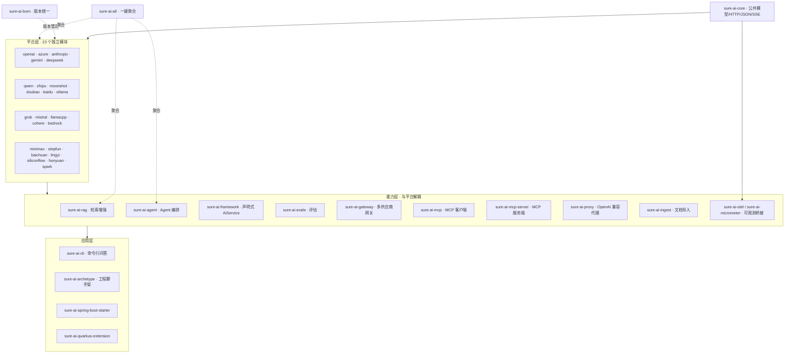
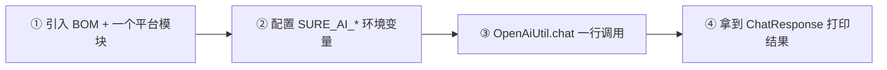
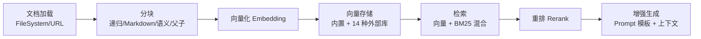
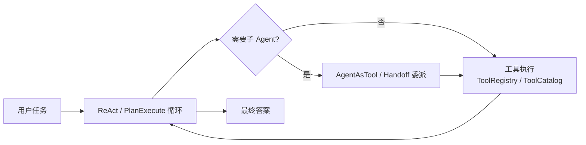

# sureai

> **零第三方依赖的 Java 大模型接入工具基础设施。** 每个主流 AI 平台一个独立模块、一个静态入口工具类，模块间互相隔离、按需引入，一行调用。

[](https://central.sonatype.com/artifact/io.github.tasure/sure-ai-core)
[](https://github.com/TASure/sureai/actions/workflows/ci.yml)
[](LICENSE)
[](docs/capabilities.md)
[](https://openjdk.org/projects/jdk/25/)
[](https://github.com/TASure/sureai/stargazers)
[](https://github.com/TASure/sureai/releases)

> Stars / Downloads 为 shields.io 动态徽章：Stars 实时同步 GitHub 收藏数；Downloads 统计 Release 产物累计下载量（发版前显示 0 属正常）。最新发布版本以 Maven Central 徽章为准。

## 为什么选择 sureai

| 维度 | sureai | LangChain4j | Spring AI |
|------|--------|-------------|-----------|
| 第三方运行期依赖 | **零**（仅 JDK + 自研 JSON/HTTP，唯一依赖 `sure-core`） | 传递依赖链庞大 | 绑定 Spring 生态 |
| 开箱即用 | **静态工具类一行调用**（`OpenAiUtil.chat(...)`） | 需 Builder 装配 | 需 `@Configuration` + Bean |
| 平台覆盖 | **23 个平台全覆盖**（含百度/智谱/豆包/MiniMax/混元/星火等国产） | 部分覆盖 | 部分覆盖 |
| 模块隔离 | **模块级零依赖**，只引入需要的平台 | 整体引入 | 整体引入 |
| JDK 要求 | **25+** | 17+ | 17+ |

## 架构总览

45 个 Maven 模块按「核心 → 平台 → 能力 → 应用」四层组织，核心零第三方依赖，平台模块两两隔离：



**核心设计原则**：平台模块只依赖 `sure-ai-core`，模块间零依赖；内置自研 JSON 解析与 SSE 读取；静态工具类双检锁懒加载、未初始化自动读环境变量；平台特有鉴权（JWT / access_token 缓存 / SigV4 等）封装在各模块内。

## 快速开始（5 分钟入门）



**① 引入依赖**（BOM 统一版本，这里用 OpenAI；其余 22 个平台坐标见[平台矩阵](#平台支持矩阵)）：

```xml
<dependencyManagement>
  <dependencies>
    <dependency>
      <groupId>io.github.tasure</groupId>
      <artifactId>sure-ai-bom</artifactId>
      <version>3.0.0</version>
      <type>pom</type>
      <scope>import</scope>
    </dependency>
  </dependencies>
</dependencyManagement>

<dependencies>
  <dependency>
    <groupId>io.github.tasure</groupId>
    <artifactId>sure-ai-openai</artifactId>
  </dependency>
</dependencies>
```

> 想一次引入全部平台 + RAG + Agent，把平台依赖换成聚合模块 `sure-ai-all`（`<type>pom</type>`）。

**② 配置环境变量**：

```bash
export SURE_AI_OPENAI_API_KEY=sk-xxx
```

**③ 一行调用**：

```java
import com.sure.ai.openai.OpenAiUtil;

String reply = OpenAiUtil.chat("gpt-4o-mini", "你好！").firstText();
System.out.println(reply);
```

**④ 跑通**：JDK 25+，直接运行 main 方法即可。更多「照着抄」场景见 [docs/COOKBOOK.md](docs/COOKBOOK.md)。

## 核心能力一览

| 能力 | 模块 | 一句话说明 | 文档 |
|------|------|-----------|------|
| 对话 / 流式 / Embedding | `sure-ai-*`（平台模块） | 23 平台统一协议引擎，SSE 流式逐片回调 | [capabilities.md](docs/capabilities.md) |
| 图像 / 视频 / 语音 | `sure-ai-*` | `ImageClient`/`VideoClient`/`AudioClient`，异步平台内部轮询屏蔽、对外同步 | [images.md](docs/images.md) · [video.md](docs/video.md) · [audio.md](docs/audio.md) |
| RAG 检索增强 | `sure-ai-rag` | 加载→分块→向量化→检索（向量+BM25 混合）→重排→增强生成 | [rag.md](docs/rag.md) |
| Agent 编排 | `sure-ai-agent` | ReAct / Plan-Execute / 多 Agent 并行 / 检查点 / HITL / 记忆 / Skills / 子 Agent / 工具市场 | [agent.md](docs/agent.md) · [agent-skills.md](docs/agent-skills.md) |
| 声明式 AiService | `sure-ai-framework` | 接口 + 注解 → JDK 动态代理即 AI 服务；Advisor 链 + 语义缓存 | [framework.md](docs/framework.md) |
| 评估 | `sure-ai-evals` | 数据集 → 指标（确定性/语义/LLM 裁判）→ 报告 → CI 阈值断言 → 录制回放 | [evals.md](docs/evals.md) |
| AI Gateway | `sure-ai-gateway` | 多供应商路由 / 故障转移 / 熔断 / 密钥池 / 配额 | [gateway.md](docs/gateway.md) |
| MCP 客户端/服务端 | `sure-ai-mcp` / `sure-ai-mcp-server` | 接入 MCP 工具；把 sureai 能力反向暴露为 MCP Server | [mcp.md](docs/mcp.md) · [mcp-server.md](docs/mcp-server.md) |
| 文档导入 | `sure-ai-ingest` | 本地文件/URL → `Document`，内置 TXT/MD/HTML/PDF（POI 可选） | [ingest.md](docs/ingest.md) |
| 可观测性 | `sure-ai-otel` / `sure-ai-micrometer` | OTel GenAI 语义约定 / Micrometer / Langfuse 导出 | [observability.md](docs/observability.md) |
| 生产韧性 | `sure-ai-core` | 重试回调 / 限流 / 熔断 / 响应缓存 / 成本计量 / CircuitBreaker | [observability.md](docs/observability.md) · [cache.md](docs/cache.md) |

## 平台支持矩阵

23 个平台，每个一个独立模块与静态工具类（核心能力列，完整 22 项能力矩阵见 [docs/capabilities.md](docs/capabilities.md)）：

| 平台 | artifactId | 流式 | Embedding | 图像 | 视频 | 语音 TTS/STT | Function Calling |
|------|-----------|------|-----------|------|------|-------------|-----------------|
| OpenAI | `sure-ai-openai` | ✅ | ✅ | ✅ DALL·E 3 | ✅ Sora 2 | ✅ / ✅ | ✅ |
| Azure OpenAI | `sure-ai-azure` | ✅ | ✅ | ✅ DALL·E 3 | ✅ Sora 2 | ✅ / ✅ | ✅ |
| Anthropic | `sure-ai-anthropic` | ✅ | ❌ | ❌ | ❌ | ❌ | ✅ |
| Google Gemini | `sure-ai-gemini` | ✅ | ✅ | ✅ Imagen | ❌ Veo | ❌ | ✅ |
| DeepSeek | `sure-ai-deepseek` | ✅ | ❌ | ❌ | ❌ | ❌ | ✅ |
| 通义千问 | `sure-ai-qwen` | ✅ | ✅ | ✅ 万相 | ✅ Wan | ✅ / ✅ | ✅ |
| 智谱 GLM | `sure-ai-zhipu` | ✅ | ✅ | ✅ CogView | ✅ CogVideoX | ✅ / ✅ | ✅ |
| Moonshot | `sure-ai-moonshot` | ✅ | ✅ | ❌ | ❌ | ❌ | ✅ |
| 豆包 | `sure-ai-doubao` | ✅ | ✅ | ❌ | ✅ Seedance | ✅ / ✅ | ✅ |
| 百度千帆 | `sure-ai-baidu` | ✅ | ✅ | ✅ 文心一格 | ❌ | ✅ / ✅ | ✅ |
| Ollama | `sure-ai-ollama` | ✅ | ✅ | ❌ | ❌ | ❌ | ✅ |
| Grok (xAI) | `sure-ai-grok` | ✅ | ❌ | ❌ | ❌ | ❌ | ✅ |
| Mistral | `sure-ai-mistral` | ✅ | ✅ | ❌ | ❌ | ❌ | ✅ |
| Cohere | `sure-ai-cohere` | ✅ | ✅ | ❌ | ❌ | ❌ | ✅ |
| llama.cpp | `sure-ai-llamacpp` | ✅ | ✅ | ❌ | ❌ | ❌ | ✅ |
| AWS Bedrock | `sure-ai-bedrock` | ✅ | ❌ | ❌ | ❌ | ❌ | ✅ |
| MiniMax | `sure-ai-minimax` | ✅ | ❌ | ❌ | ❌ | ❌ | ✅ |
| 阶跃星辰 StepFun | `sure-ai-stepfun` | ✅ | ❌ | ❌ | ❌ | ❌ | ✅ |
| 百川 Baichuan | `sure-ai-baichuan` | ✅ | ❌ | ❌ | ❌ | ❌ | ✅ |
| 01.AI 零一万物 | `sure-ai-lingyi` | ✅ | ❌ | ❌ | ❌ | ❌ | ✅ |
| 硅基流动 SiliconFlow | `sure-ai-siliconflow` | ✅ | ✅ | ❌ | ❌ | ❌ | ✅ |
| 腾讯混元 Hunyuan | `sure-ai-hunyuan` | ✅ | ✅ | ❌ | ❌ | ❌ | ✅ |
| 讯飞星火 Spark | `sure-ai-spark` | ✅ | ❌ | ❌ | ❌ | ❌ | ✅ |

逐平台文档见 `docs/platforms/` 与 [bedrock.md](docs/bedrock.md) / [cohere.md](docs/cohere.md) / [grok.md](docs/grok.md) / [mistral.md](docs/mistral.md) / [llamacpp.md](docs/llamacpp.md)。

## 关键流程示例

### 流式调用

```java
OpenAiUtil.chatStream(
    ChatRequest.builder()
        .model("gpt-4o-mini")
        .messages(List.of(ChatMessage.user("用一句话介绍 Java。")))
        .build(),
    chunk -> { if (chunk.deltaText() != null) System.out.print(chunk.deltaText()); }
);
```

### Function Calling

```java
ToolFunction weatherFn = ToolFunction.of("getWeather", "查询指定城市的当前天气",
    "{\"type\":\"object\",\"properties\":{\"city\":{\"type\":\"string\"}},\"required\":[\"city\"]}");

ChatRequest req = ChatRequest.builder()
    .model("gpt-4o-mini")
    .messages(List.of(ChatMessage.user("上海今天天气怎么样？")))
    .tools(List.of(ToolSpec.of(weatherFn)))
    .build();

ChatResponse resp = OpenAiUtil.chat(req);
// 执行工具后，将结果作为 ChatMessage.tool(toolCallId, result) 追加再次请求
```

### RAG 检索增强问答



```xml
<dependency>
  <groupId>io.github.tasure</groupId>
  <artifactId>sure-ai-rag</artifactId>
  <version>3.0.0</version>
</dependency>
```

```java
OpenAiClient client = OpenAiClient.builder().apiKey("sk-xxx").build();

RagPipeline pipeline = RagUtil.pipeline(client, client,
    OpenAiModels.GPT_4O_MINI, OpenAiModels.TEXT_EMBEDDING_3_SMALL);

pipeline.ingest("sureai-intro", "sureai 是一个零第三方依赖的 Java 大模型接入工具库……");
ChatResponse answer = pipeline.ask("sureai 支持哪些能力？");
```

高级能力：向量库已适配 Milvus / Chroma / Qdrant / Pinecone / Weaviate / Elasticsearch / OpenSearch / Redis / PGVector / Typesense / Cassandra / MongoDB / Neo4j 共 13 种外部实现（合计 14 种）；检索策略含 HyDE / Multi-Query(RRF) / CRAG / 父子分块 / 语义分块 / 多模态 RAG / GraphRAG / RAG 评估。见 [docs/rag.md](docs/rag.md)、[docs/vector-stores.md](docs/vector-stores.md)。

### Agent 编排



```java
ToolRegistry registry = new ToolRegistry();
registry.register(DateTimeTool.INSTANCE);
registry.register(HttpTool.builder().ssrfGuard(...).build());

ReActAgent agent = ReActAgent.builder()
    .client(client)
    .model("gpt-4o-mini")
    .registry(registry)
    .build();

String answer = agent.run("今天是星期几？");
```

更多：多 Agent 并行（`AgentOrchestrator`）、检查点持久化、HITL 审批、长期记忆、Agent Skills（SKILL.md 渐进式加载）、子 Agent 层级委派、工具市场 `ToolCatalog`、MCP 工具接入。见 [docs/agent.md](docs/agent.md)、[docs/agent-advanced.md](docs/agent-advanced.md)、[docs/agent-skills.md](docs/agent-skills.md)、[docs/mcp.md](docs/mcp.md)。

## 生态与工具

| 工具 | 模块 | 说明 | 文档 |
|------|------|------|------|
| Spring Boot Starter | `sure-ai-spring-boot-starter` | 自动配置 + `@Autowired` 注入 | [spring-boot.md](docs/spring-boot.md) |
| Quarkus 扩展 | `sure-ai-quarkus-extension` | Arc 合成 Bean 条件装配 | [quarkus-extension.md](docs/quarkus-extension.md) |
| 命令行 | `sure-ai-cli` | `chat / stream / rag / list / repl / new / config / doctor / version`，不写 Java 即可体验 | [cli.md](docs/cli.md) |
| 模板应用库 | `sure-ai-templates` | `sureai new <template>` 一键生成 RAG/客服/代码助手工程 | [templates.md](docs/templates.md) |
| 文档站 | `sure-ai-docsite` | 把 docs/ Markdown 生成可发布静态站点（纯 JDK） | [docsite.md](docs/docsite.md) |
| 工程脚手架 | `sure-ai-archetype` | `mvn archetype:generate` 一键生成工程 | [COOKBOOK.md](docs/COOKBOOK.md) |
| 示例 | `sure-ai-examples` | 离线可跑 demo（`ExamplesRunner`） | [COOKBOOK.md](docs/COOKBOOK.md) |
| 原生编译 | 全库元数据 | GraalVM native-image 免手写配置 | [native-image.md](docs/native-image.md) |
| OpenAI 兼容代理 | `sure-ai-proxy` | LiteLLM proxy 模式独立 HTTP 服务 | [proxy.md](docs/proxy.md) |
| 成本计量 | `sure-ai-core` | 价格目录 + 单次/汇总成本 | [cost.md](docs/cost.md) |
| 全链路异步 | `sure-ai-core` | `AsyncClients` 虚拟线程包装 | [async.md](docs/async.md) |

## 环境变量约定

统一规则：**`SURE_AI_<平台>_API_KEY`**（必填，Ollama 除外）+ **`SURE_AI_<平台>_BASE_URL`**（可选，覆盖默认地址）。特例：

- **百度千帆**：还需 `SURE_AI_BAIDU_SECRET_KEY`（access_token 自动缓存）
- **智谱**：`SURE_AI_ZHIPU_API_KEY` 为 `id.secret` 格式（SDK 生成 JWT）
- **讯飞星火**：`SURE_AI_SPARK_API_KEY` 为控制台 `APIPath:APIKey` 整体
- **Azure**：`SURE_AI_AZURE_RESOURCE`（资源名）或 `SURE_AI_AZURE_BASE_URL`（完整地址）

完整对照见 [docs/platforms/](docs/platforms/) 各平台文档。

## 文档索引

| 主题 | 文档 |
|------|------|
| 快速入门 / 场景 | [COOKBOOK.md](docs/COOKBOOK.md) · [faq.md](docs/faq.md) |
| 架构设计 | [design.md](docs/design.md) · [capabilities.md](docs/capabilities.md) · [comparison.md](docs/comparison.md) · [strategy-comparison.md](docs/strategy-comparison.md) |
| 对话能力 | [thinking.md](docs/thinking.md) · [structured-output.md](docs/structured-output.md) · [multimodal.md](docs/multimodal.md) · [grounding.md](docs/grounding.md) · [batches.md](docs/batches.md) · [prompt-template.md](docs/prompt-template.md) · [realtime.md](docs/realtime.md) |
| 媒体生成 | [images.md](docs/images.md) · [video.md](docs/video.md) · [audio.md](docs/audio.md) · [rerank.md](docs/rerank.md) |
| RAG / 向量库 | [rag.md](docs/rag.md) · [vector-stores.md](docs/vector-stores.md) · [ingest.md](docs/ingest.md) |
| Agent / MCP | [agent.md](docs/agent.md) · [agent-advanced.md](docs/agent-advanced.md) · [agent-skills.md](docs/agent-skills.md) · [mcp.md](docs/mcp.md) · [mcp-server.md](docs/mcp-server.md) |
| 框架 / 网关 | [framework.md](docs/framework.md) · [gateway.md](docs/gateway.md) · [proxy.md](docs/proxy.md) |
| 评估 / 可观测 | [evals.md](docs/evals.md) · [observability.md](docs/observability.md) · [cost.md](docs/cost.md) · [cache.md](docs/cache.md) · [circuit-breaker.md](docs/circuit-breaker.md) |
| 平台专项 | [bedrock.md](docs/bedrock.md) · [cohere.md](docs/cohere.md) · [grok.md](docs/grok.md) · [mistral.md](docs/mistral.md) · [llamacpp.md](docs/llamacpp.md) |
| 工程化 | [benchmark.md](docs/benchmark.md) · [native-image.md](docs/native-image.md) · [cli.md](docs/cli.md) · [templates.md](docs/templates.md) · [docsite.md](docs/docsite.md) · [RELEASING.md](docs/RELEASING.md) · [trust.md](docs/trust.md) |

## 构建

```bash
# 需要 JDK 25+ 和 Maven 3.9+
mvn -B clean verify
```

执行：编译 → 单元测试（3200+ 用例，零真实网络）→ checkstyle → spotbugs → jacoco 覆盖率门禁（≥98%）→ license 头校验。

## 贡献指南

欢迎提交 Issue 和 PR！详见 [CONTRIBUTING.md](CONTRIBUTING.md)。

## 讨论与支持

- **使用疑问 / 想法交流 / 路线图探讨**：请到 [GitHub Discussions](https://github.com/TASure/sureai/discussions) 发帖（问答类先看置顶帖；路线图/版本规划放 *Roadmap* 分类）。
- **Bug 与功能请求**：用 [Issues](https://github.com/TASure/sureai/issues) 并按模板提交。
- **安全漏洞**：**不要**公开 Issue 或 Discussions，按 [SECURITY.md](SECURITY.md) 的私下渠道邮件报告。
- **供应链完整性 / 校验发布产物**：见 [docs/trust.md](docs/trust.md)。

## 开发与治理团队

后续迭代由「软件研发小组」负责：小组长统筹需求与验收，产品经理定需求与验收标准，软件架构师做模块与 API 设计，研发工程师实现，全栈代码质检官独立审查（P0/P1/P2 分级）。详见 [docs/TEAM.md](docs/TEAM.md)，机器可读配置见 [`.team/`](.team/)。

## License

[Apache License 2.0](LICENSE) © sureai contributors
