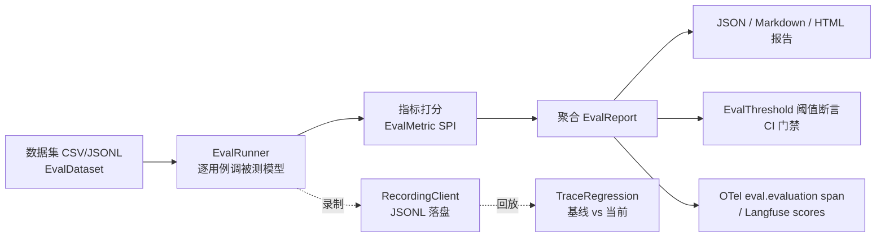

# 评估与可观测（Evals）

sureai 在 v2.8.0 新增通用评估模块 `sure-ai-evals`（包 `com.sure.ai.evals`）：把「一批用例 → 逐用例调用被测模型 → 逐指标打分 → 聚合报告 → 阈值断言 → 录制回放回归」收口为一条链，对标 Spring AI 2.0 的 `Evaluator` 体系与 LangChain4j 的 evaluation 能力，但保持 sureai 一贯的**零第三方运行期依赖**——模块只依赖 `sure-ai-core`，数据集解析、CSV/JSONL 读写、报告渲染、录制落盘全部为手写实现，不引入 Jackson / OpenCSV / 任何评估框架。



## 定位与分工

| 能力 | 模块 | 包 | 面向 |
|---|---|---|---|
| **通用对话评估** | `sure-ai-evals` | `com.sure.ai.evals` | 任意 `AiClient` 的问答质量 / 延迟 / 成本批量打分，与检索无关 |
| **RAG 专用评估** | `sure-ai-rag` | `com.sure.ai.rag.evaluation` | RAG 问答的忠实度 / 上下文精度 / 召回率（依赖检索上下文文档） |

二者**互补、互不依赖**：

- `sure-ai-evals` 不感知「检索上下文文档」，只做「请求 ⇄ 响应」成对快照与通用指标打分；
- `sure-ai-rag` 的 `RagTrace` / `RagEvaluator` 记录问题 + 召回上下文 + 参考答案，服务于 `faithfulness` / `context_precision` 等 RAG 专属指标；
- 复用点：两者共享 core 的 `AiClient` / `ChatRequest` / `ChatResponse` 模型与 `MetricsCollector` 观测体系；RAG 管线产出的答案同样可以交给 `EvalRunner` 跑通用指标。

引入坐标（已注册进 `sure-ai-bom` 与 `sure-ai-all`）：

```xml
<dependency>
    <groupId>io.github.tasure</groupId>
    <artifactId>sure-ai-evals</artifactId>
    <version>2.8.0-SNAPSHOT</version>
</dependency>
```

## 快速上手

下面这段**完全离线**（被测模型与裁判模型都用脚本化 fake client），演示数据集 → 指标 → 执行 → 报告 → 阈值断言的最短路径：

```java
// 1. 构造数据集（代码内直构；也可从 CSV/JSONL 加载，见下文）
EvalDataset dataset = EvalDataset.of("qa-smoke", List.of(
        EvalCase.of("c1", "法国首都是哪里？", "巴黎"),
        EvalCase.of("c2", "1+1等于几？", "2"),
        EvalCase.of("c3", "用一句话介绍 Java", "Java 是一门面向对象的编程语言")));

// 2. 装配指标：确定性指标 + LLM 裁判（这里裁判用离线脚本客户端，真实环境换成 OpenAiClient 等）
List<EvalMetric> metrics = List.of(
        ExactMatchMetric.builder().build(),
        ContainsMetric.builder().ignoreCase(true).build(),
        LlmJudgeMetric.builder(judgeClient, "judge-model")
                .mode(JudgeMode.BINARY)
                .rubric("答案是否正确、简洁")
                .build());

// 3. 跑评估（try-with-resources 自动关闭 runner）
try (EvalRunner runner = EvalRunner.builder(chatClient, "under-test-model")
        .addMetric(ExactMatchMetric.builder().build())
        .addMetric(LlmJudgeMetric.builder(judgeClient, "judge-model")
                .mode(JudgeMode.BINARY).build())
        .build()) {
    EvalReport report = runner.run(dataset);

    // 4. 渲染报告并做 CI 阈值断言
    System.out.println(new EvalMarkdownReportWriter().render(report));
    EvalAssertions.assertMeets(report, EvalThreshold.builder()
            .putMean("exact_match", 0.5)
            .putPassRate("llm_judge", 0.6)
            .build());   // 不达标抛 AssertionError，CI 直接红
}
```

更省事的一站式入口是 `EvalUtil`：

```java
EvalReport report = EvalUtil.run(chatClient, "my-model", dataset,
        ExactMatchMetric.builder().build(), new ContainsMetric());
```

## 数据集

### EvalCase / EvalDataset

`EvalCase`（单条用例，不可变）字段：

| 字段 | 类型 | 说明 |
|---|---|---|
| `id` | `String` | 用例 ID；缺省时自动生成 `case-<hash>` |
| `input` | `List<ChatMessage>` | 送入被测模型的完整消息列表（可多轮）；`userInput(String)` 快速构造单条 user 消息 |
| `expected` | `String` | 参考答案（确定性 / 语义 / 裁判指标据此打分）；可 `null` |
| `tags` | `List<String>` | 标签（按场景分组，如 `math` / `writing`） |
| `metadata` | `Map<String,Object>` | 任意元数据 |
| `expectedTools` | `List<String>` | 期望出现的工具名有序序列（工具调用正确性核对预留） |

`EvalDataset`（一组有序用例）提供 `of(name, cases)` / `builder()` / `byId(id)` / `get(i)` / `size()`。

### CSV 格式约定

`CsvDatasetLoader` 为零依赖手写解析（支持引号包裹、字段内逗号/换行、`""` 转义、CRLF、UTF-8 含 BOM 容错、空行跳过）。表头列名**大小写不敏感、去首尾空白**后映射：

| 表头（别名） | 映射到 |
|---|---|
| `input` / `question` / `prompt` | 模型输入（单条 user 消息） |
| `expected` / `answer` / `reference` | 期望输出 |
| `id` | 用例 ID |
| `tags` | 标签，按分隔符切分（默认 `;`） |
| `expectedTools` / `expected_tools` | 期望工具名序列，同样按分隔符切分 |
| 其它列 | 整列并入用例 `metadata`（键为原列名） |

示例 `qa.csv`：

```csv
id,input,expected,tags,difficulty
c1,法国首都是哪里？,巴黎,geo;capitals,1
c2,"1+1等于几？""直接写数字""",2,math,1
c3,用一句话介绍 Java,"Java 是一门面向对象的编程语言。",writing,2
```

容错与坏行处理：

- 数据行列数少于表头 → 缺失列补空串；多出的列以 `extra_<列号>` 并入 metadata；
- **无 input 列或 input 为空的行视为坏行**：默认 `BadLineStrategy.SKIP` 跳过，`FAIL` 立即抛 `EvalException`（含行号）；
- 引号未闭合属于文件级损坏，**始终**抛 `EvalException`；
- 文件名/读取统一 UTF-8，开头 BOM（U+FEFF）自动剥离。

```java
EvalDataset dataset = CsvDatasetLoader.builder()
        .name("qa-from-csv")
        .tagsSeparator(";")          // tags / expectedTools 列分隔符
        .badLineStrategy(CsvDatasetLoader.BadLineStrategy.SKIP)
        .build()
        .load(Path.of("qa.csv"));
```

### JSONL 格式约定

`JsonlDatasetLoader` 逐行解析一个 JSON 对象（复用 core 内置 `Json`）：

```jsonl
{"id":"c1","input":"法国首都是哪里？","expected":"巴黎","tags":["geo","capitals"]}
{"id":"c2","input":[{"role":"user","content":"1+1等于几？"}],"expected":"2","tags":["math"]}
{"id":"c3","input":[{"role":"system","content":"你是严谨助手。"},{"role":"user","content":"介绍 Java"}],"expected":"Java 是一门面向对象的语言。","metadata":{"difficulty":2}}
```

字段识别：`input` / `question` / `prompt`——字符串视为单条 user 消息；数组为消息序列（字符串元素视为 user，对象元素按 `role`/`content` 还原 system/assistant/user）。`expected` / `answer` / `reference` 为参考答案；`tags` / `expectedTools` 为字符串数组；`metadata` 对象递归转 `Map`。空行跳过；单行 JSON 语法错误或根类型不是对象按 `BadLineStrategy` 处理（默认 `SKIP`，`FAIL` 抛含行号的 `EvalException`）；缺 input 的行同样按坏行处理。

## 指标 SPI

`EvalMetric` 是扩展点：

```java
public interface EvalMetric {
    String name();                                            // 结果 Map 的键
    MetricResult evaluate(EvalCase evalCase, EvalOutcome outcome, EvalContext context);
    default double passThreshold() { return 1.0; }           // 分数 ≥ 阈值记通过
}
```

取值约定：

- **分数归一化到 [0,1]**，越高越好（`MetricResult` 紧凑构造器自动 clamp，NaN 保留）；二元指标只取 0/1；
- **`Double.NaN` 表示「不适用」**（如缺参考答案、缺 token usage），聚合时剔除、不计入均值，只计入 `nanCount`；
- `EvalOutcome` 承载被测模型的实际响应 / 实际文本（null 归一为空串）/ 耗时纳秒 / 异常；执行失败的用例仍会喂给指标（多数确定性指标据此判 0 分），但不中断整批；
- `EvalContext.create(model)` 在一次 run 内对所有用例共享，只承载运行级元数据；指标所需的外部客户端（裁判 `AiClient`、`EmbeddingClient`）通过指标构造器注入；
- **任何指标内部异常都不向上抛出**——runner 捕获后记为该指标 `notApplicable("指标异常: ...")`，不影响其它指标与用例。

```java
public record MetricResult(double score, String reason) {
    static MetricResult of(double score, String reason);
    static MetricResult pass(String reason);      // score=1
    static MetricResult fail(String reason);      // score=0
    static MetricResult notApplicable(String reason); // score=NaN
    boolean applicable();
    boolean passedAt(double threshold);
}
```

## 内置指标

### LlmJudgeMetric（LLM-as-judge）

调用裁判模型对被测输出打分，四种 `JudgeMode`：

| 模式 | 裁判输出约定 | 归一化口径 |
|---|---|---|
| `BINARY` | 按 rubric 输出 YES / NO | YES→1.0，NO→0.0 |
| `SCALE_1_TO_5` | 输出 1~5 整数 | `(n-1)/4`（1→0，5→1） |
| `SCORE_100` | 输出 0~100 分数 | `n/100`（≤1 的小数原样保留） |
| `PAIRWISE` | 实际输出(A) vs 参考答案(B)，输出 A / B / TIE | A 胜 1.0 / 平 0.5 / B 胜 0.0 |

```java
LlmJudgeMetric judge = LlmJudgeMetric.builder(judgeClient, "judge-model")
        .mode(JudgeMode.SCALE_1_TO_5)          // 默认 BINARY
        .rubric("答案是否正确、简洁、无幻觉")      // 替换模板里的 {rubric}
        .maxTokens(512)                        // 默认 512
        .name("llm_judge")                      // 默认 llm_judge
        .passThreshold(0.6)                     // 默认 0.6（二元模式可设 1.0）
        .build();
```

提示词模板内置中文，占位符 `{input}` / `{expected}` / `{actual}` 渲染时替换；`rubric` 为空时用「按正确性与相关性判断」兜底。

**容错（绝不向上抛出）**：裁判调用抛异常、返回空文本、输出无法解析时——默认返回 `notApplicable`（NaN，聚合剔除）；也可 `.onUnparseableDefaultScore(0.5)` 改为返回可复现的固定默认分（便于 CI 保持确定性）。解析细节：BINARY 同时命中 yes/no 线索判不可判定；SCALE/SCORE 用正则抽首个数字，越界判不可判定；PAIRWISE 同时命中 A/B 线索时若含 TIE/「平」记 0.5，否则不可判定。

### ExactMatchMetric（精确匹配）

归一化后比较实际输出与期望输出是否完全一致。`normalizeWhitespace`（默认 true：去首尾空白 + 内部连续空白折叠为单空格）、`ignoreCase`（默认 false）。期望为 `null` 返回 `notApplicable("缺期望输出")`。指标名固定 `exact_match`，阈值默认 1.0。

### ContainsMetric（包含）

实际输出须包含期望子串。默认把整条 `expected` 当一个子串；`delimiter(";")` 切分为多个子串；`allRequired(true)` 要求全部命中才通过（默认 false=任一命中即通过）；`ignoreCase` 可选。期望为 `null` 或切分后为空 → `notApplicable`。指标名固定 `contains`。

### RegexMetric（正则）

把期望输出当作正则表达式在实际输出上匹配。`mode(Mode.FIND)`（默认，`find()` 部分匹配）或 `mode(Mode.MATCHES)`（`matches()` 全串匹配）。期望为 `null` → `notApplicable`；**期望正则非法时判 0 分**并在理由中给出编译错误（确定性失败，不抛出）。指标名固定 `regex`。

### JsonSchemaValidityMetric（JSON Schema 合法性）

把实际输出当作 JSON，校验其与目标类 Schema 的一致度。目标类 Schema 在构造时由 core `JsonSchemaGenerator.generate(Class)` 一次性生成；校验为**结构化子集校验**：根必须是对象；`required` 字段必须存在且 JSON 类型匹配（string/integer/number/boolean/array/object）；可选字段缺失不扣分，一旦出现类型必须匹配；枚举字段值须在枚举列表内。得分 = 通过检查数 / 应检数。

容错：实际输出为空 / JSON 解析失败 / 根不是对象 → 判 0 分并说明；空 Schema 判通过。本指标**不要求用例带 expected**，故不适用场景为实际输出为空。

```java
JsonSchemaValidityMetric metric = JsonSchemaValidityMetric.builder(OrderDto.class).build();
```

### EmbeddingSimilarityMetric（语义相似度）

用 `EmbeddingClient` 计算期望输出与实际输出的**余弦相似度**作为得分（clamp 到 [0,1]），通过阈值即相似度阈值，**默认 0.8**。任何异常均不向上抛出：缺期望输出、实际输出为空、embedding 调用失败 / 返回空向量、零范数向量（余弦无定义）→ 一律 `notApplicable`。指标名默认 `embedding_similarity`。

```java
EmbeddingSimilarityMetric m = EmbeddingSimilarityMetric
        .builder(embeddingClient, "text-embedding-3-small")
        .threshold(0.85)   // 默认 0.8
        .build();
```

### LatencyMetric（延迟运行指标）

把端到端耗时（毫秒）归一化为 [0,1]：`ms ≤ targetMs` 得 1.0；`ms ≥ limitMs` 得 0.0；其间线性衰减 `1 - (ms-targetMs)/(limitMs-targetMs)`。默认 `targetMs=1000`、`limitMs=3000`、通过阈值 0.5。不依赖期望输出，任何用例都适用。指标名固定 `latency`。

### TokenCostMetric（token / 成本运行指标）

以 **total tokens** 作为成本代理（core 不携带模型价格表，不做真实货币换算），归一化公式与 LatencyMetric 同形：默认 `targetTokens=500`、`limitTokens=2000`、通过阈值 0.5。响应缺 `TokenUsage`（执行失败或平台未返回用量）时返回 `notApplicable("缺 token usage")`。指标名固定 `token_cost`。

## EvalRunner 批量执行

```java
try (EvalRunner runner = EvalRunner.builder(client, "my-model")
        .addMetric(ExactMatchMetric.builder().build())
        .addMetric(LlmJudgeMetric.builder(judgeClient, "judge-model").build())
        .concurrency(4)                       // 可选：固定 4 线程池，close() 时关闭
        // .executorService(myPool)            // 或注入外部线程池（runner 不关闭它）
        .addListener(myListener)              // 可选：用例级钩子
        .build()) {
    EvalReport report = runner.run(dataset);
}
```

行为要点：

- **失败用例隔离**：单条用例模型调用异常只记为该用例 `succeeded=false`，不中断整批；
- **指标异常隔离**：单个指标抛异常只记为该指标 `notApplicable`；
- **并发**：默认顺序执行；`concurrency(n)` 创建内部固定线程池并由 runner 生命周期管理；无论并发与否，明细与统计均按数据集**原始顺序**排列，统计不依赖执行顺序；
- **聚合**：每指标产出 `MetricStats`（适用数 / NaN 数 / 均值 / min / max / 通过数 / 通过率）；NaN 剔除后再算均值与极值；报告同时汇总总 prompt/completion/token、失败用例数、延迟 **p50 / p95**（毫秒）。

`EvalRunListener` 是用例级扩展点（`onCaseStarted` / `onCaseComplete`，全部 default 空实现，钩子异常被 runner 捕获忽略），录制回放客户端即基于此挂钩落盘。

## 报告

一次 `run` 产出不可变的 `EvalReport`：数据集名 / 被测模型 / 起止时间戳 / 每用例明细（`CaseDetail`：id、标签、成功与否、错误信息、耗时、token、实际文本、逐指标结果）/ 每指标 `MetricStats` / 总 token / 失败数 / p50/p95。访问器有 `detailByCaseId(id)`、`metricStats(name)`、`failedCaseDetails()` 等。

三种写出器，均为 `render(report)` 返回字符串、`write(report, Path)` 落盘：

| 写出器 | 特点 |
|---|---|
| `EvalJsonReportWriter` | 结构化 JSON（运行元信息 → 汇总 → 每指标统计 → 逐用例逐指标明细）；NaN 序列化为 JSON `null`，便于下游程序消费与基线比对 |
| `EvalMarkdownReportWriter` | 汇总表（均值 / 通过率 / 适用 / NaN / min / max）+ 失败用例清单 + 逐用例指标表；`|` 与换行转义防破表 |
| `EvalHtmlReportWriter` | **自包含单文件**：内联 CSS、无任何外链 / CDN / 脚本网络依赖，动态文本全部 HTML 转义，可直接离线发给同事看 |

Markdown 报告片段示例：

```text
# 评估报告：qa-smoke

- 被测模型：`my-model`
- 用例数：3，失败：0
- 总 token：45（prompt 30 / completion 15）
- 延迟 p50/p95：12.3 / 20.1 ms

## 指标汇总

| 指标 | 均值 | 通过率 | 适用 | NaN | 最小 | 最大 |
| --- | --- | --- | --- | --- | --- | --- |
| exact_match | 0.667 | 0.667 | 3 | 0 | 0.000 | 1.000 |
| llm_judge | 0.800 | 1.000 | 3 | 0 | 0.000 | 1.000 |
```

## CI 阈值断言

`EvalThreshold` 是「指标名 → 最低均分 / 最低通过率」的不可变门禁表：

```java
EvalThreshold threshold = EvalThreshold.builder()
        .putMean("exact_match", 0.7)     // 该指标均分 ≥ 0.7
        .putPassRate("llm_judge", 0.6)  // 该指标通过率 ≥ 0.6
        .build();
EvalAssertions.assertMeets(report, threshold);   // 任一不满足抛 AssertionError
```

未在阈值表中的指标不约束；阈值表要求但报告缺失或全 NaN 的指标**视为不达标**。`AssertionError` 消息含指标名、实际值、期望值，并附上失败用例明细——直接挂在 CI 流水线里，质量退化即红灯。

## 录制回放与回归（golden dataset 工作流）

把「真实后端响应」录制成 JSONL 基线，之后**零网络**回放重跑，是离线质量回归的标准做法：

```java
// ① 录制当次：真实后端包一层 RecordingClient，每次 chat() 后把请求/响应成对追加为一行 JSONL
Path golden = Path.of("target/golden-qa.jsonl");
EvalReport baseline;
try (RecordingClient recording = RecordingClient.record(realClient, golden);
        EvalRunner runner = EvalRunner.builder(recording, "my-model")
                .addMetric(ExactMatchMetric.builder().build()).build()) {
    baseline = runner.run(dataset);
}   // close() 关闭 writer；默认不关闭委托客户端

// ② 回放当次：不持有委托客户端，按「请求匹配优先、录制顺序兜底」返回录制响应，零网络
EvalReport current;
try (RecordingClient replay = RecordingClient.replay(golden);
        EvalRunner runner = EvalRunner.builder(replay, "my-model")
                .addMetric(ExactMatchMetric.builder().build()).build()) {
    current = runner.run(dataset);
}

// ③ 回归判定：基线 vs 当前，均值退化超容差（默认 0.02）即判退化
TraceRegression.RegressionResult result = TraceRegression.compare(baseline, current);
System.out.println(result.summary());
result.assertPassed();   // 存在退化抛 AssertionError
```

要点：

- **`EvalTrace`** 是单次「请求 ⇄ 响应」成对快照（JSON 往返保留 model、消息列表含 toolCalls/reasoningContent、采样参数、候选列表、token usage）；刻意不保留多模态二进制 parts、平台透传对象、rawJson——评估只依赖文本与工具调用核对；
- **回放匹配**：先用 model + 消息（role/content/toolCallId/toolCalls 函数名与参数 JSON）匹配未消费记录，匹配不到按录制顺序取下一条；用例数多于录制数（录制耗尽）抛运行期异常；
- **`TraceRegression` 判定**（分数越高越好）：按指标聚合均值比较，`delta = baseline - current`，`delta > tolerance` 判退化（`delta == tolerance` 恰好相等**不**判退化），`delta < -tolerance` 记为改善（信息项）。容差默认 `0.02`，可 `TraceRegression.builder().tolerance(0.01).tolerance("latency", 0.05).build()` 全局或按指标配置；用例按 `caseId` 对齐，逐用例逐指标分数跌幅超容差、失败用例数增加同样记退化；
- 流式边界：录制模式下 `chatStream` 把分片聚合成完整响应再落盘（聚合响应 usage 为 null），回归应关注同步 `chat` 路径。

## 可观测

### OTel：评估 run → `eval.evaluation` span

`sure-ai-otel` 增量提供 `OtelEvalTracing`，把一次 `EvalReport` 映射为一个 `eval.evaluation` span（GenAI evaluation 语义约定扩展命名空间）：

```java
// 门面入口；传 null TracerProvider/OpenTelemetry 即全空操作、零开销
OtelSupport.evalTracing(openTelemetry).record(report);
```

span 属性：`gen_ai.evaluation.dataset.name`、`gen_ai.request.model`、`gen_ai.evaluation.case_count`、`gen_ai.evaluation.failed_case_count`、`gen_ai.evaluation.total_tokens`、`gen_ai.evaluation.latency_p50/p95`，以及每指标均值动态属性 `gen_ai.evaluation.metric.<name>`（指标名经合法字符清洗，均值为 NaN 的指标跳过）。存在失败用例或任一适用指标通过率不足 1 时 span 置 `StatusCode.ERROR` 并写低基数 `error.type`（`eval.execution_failure` / `eval.assertion_failure`）。**刻意不**按用例展开子 span，避免评估 run 产生高基数 span 树。

### Langfuse：评估指标 → scores

`EvalReportLangfuseExporter` 把一次评估 run 导出为 Langfuse 的一个 `trace` + 若干 `score-create`（`dataType=NUMERIC`）：每指标一个 score（值为聚合均值，comment 带 passRate/适用数/NaN 摘要），另补 `pass_rate` / `total_tokens` / `failed_case_count` 三个数值 score；均值为 NaN 的指标不产出 score。整批经 Langfuse Ingestion 单次发送，密钥缺失即空操作无感降级，发送异常只记 warning、绝不向上抛出。

```java
// 环境变量 LANGFUSE_PUBLIC_KEY / LANGFUSE_SECRET_KEY / LANGFUSE_HOST / LANGFUSE_ENVIRONMENT
EvalReportLangfuseExporter exporter =
        LangfuseExporters.evalReportExporter(LangfuseConfig.fromEnv());
exporter.export(report);   // 返回 CompletableFuture<Void>
```

## A/B 对比

`EvalComparison.of(reportA, reportB)` 把两次 run（两个 runner / 两个模型）逐指标对比：

```java
EvalComparison cmp = EvalComparison.of(reportA, reportB);
Map<String, Double> diffs = cmp.meanDiffs();   // 每指标均分差（A − B）
int a = cmp.winsA(), tie = cmp.ties(), b = cmp.winsB();  // 逐用例逐指标 pairwise 胜/平/负
```

NaN 结果在 pairwise 比较中跳过；两报告用 `caseId` 对齐。这用于「换模型 / 换 prompt 后到底是变好还是变差」的量化决策。

## 与 RAG 评估的关系速查

| 你要评估的是 | 用什么 |
|---|---|
| 任意对话问答的正确性 / 相关性 / 延迟 / 成本，批量打分 + CI 门禁 | `sure-ai-evals`（本文档） |
| RAG 答案是否忠实于检索上下文、上下文精度 / 召回 | `sure-ai-rag` 的 `RagEvaluator`（见 [docs/rag.md](rag.md#rag-评估)） |
| 锁定真实后端响应、离线回归防退化 | `sure-ai-evals` 的 `RecordingClient` + `TraceRegression` |
| 对比两个模型 / prompt | `EvalComparison` |

## 完整配置示例

```java
EvalDataset dataset = EvalUtil.dataset("regression-smoke",
        EvalCase.of("c1", "法国首都是哪里？", "巴黎"),
        EvalCase.of("c2", "1+1等于几？", "2"));

List<EvalMetric> metrics = List.of(
        ExactMatchMetric.builder().ignoreCase(true).build(),
        ContainsMetric.builder().delimiter(";").allRequired(true).build(),
        LatencyMetric.builder().targetMs(500).limitMs(2000).build(),
        LlmJudgeMetric.builder(judgeClient, "judge-model")
                .mode(JudgeMode.BINARY).passThreshold(0.8).build());

EvalReport report;
try (EvalRunner runner = EvalRunner.builder(chatClient, "candidate-model")
        .metrics(metrics).concurrency(4).build()) {
    report = runner.run(dataset);
}

new EvalJsonReportWriter().write(report, Path.of("target/eval.json"));
new EvalHtmlReportWriter().write(report, Path.of("target/eval.html"));
EvalAssertions.assertMeets(report, EvalThreshold.builder()
        .putMean("exact_match", 0.8).putPassRate("llm_judge", 0.8).build());
```
